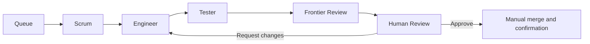

# KangBan Agentic Board

[](https://github.com/SacSresta/KangBan_Agentic_Board/actions/workflows/ci.yml)

A local coding board that turns prioritized tickets into reviewed Git changes. It runs one task at a time in an isolated worktree, keeps workflow state across restarts, and requires frontier review and human approval before a manual merge.

The MVP uses FastAPI, LangGraph, LangChain and SQLite, with a Next.js static frontend and an Electron desktop shell. **The default models are visibly labelled deterministic test fixtures. Live-model verification has not been performed.**

## Quick start

Install Git, [uv](https://docs.astral.sh/uv/getting-started/installation/) and Node.js 24. Python 3.12+ is supported; `.python-version` selects the validated Python 3.14 runtime, which uv can download. Node 22.12+ is the declared minimum.

```bash
git clone https://github.com/SacSresta/KangBan_Agentic_Board.git
cd KangBan_Agentic_Board
uv sync --locked
npm ci
npm run build
uv run --frozen python -m kanban
```

Open **http://127.0.0.1:8765**. To use the desktop shell instead of starting Python yourself, run `npm run desktop` after installation and the frontend build. Electron starts the project interpreter, reuses a matching existing service, and stops only a backend it owns. On Linux it needs a graphical session; there are no packaged installers yet.

## Connect a repository and run a ticket

1. Open Settings and select a Git repository with an initial commit and a local base branch. Existing source changes are preserved; each run creates a dedicated branch and worktree.
2. Add approved test commands as JSON argument arrays, such as `[["python", "-m", "pytest", "-q"]]`. Each executable must be available to the backend, and the target repository needs its own test dependencies.
3. Create a ticket with a description and acceptance criteria, move it to Ready, and start the queue. Priority 1 is highest. Dependencies must be Done before their dependent ticket can start.
4. Inspect the patch, test evidence, and frontier assessment. Request changes or approve the exact artifact commit.
5. Merge the displayed branch manually into the configured base branch, then select Confirm manual merge. Done requires verification that the approved commit is contained in that branch.

The board has Backlog, Ready, In Progress, Review, Awaiting Human, Approved, Blocked, and Done columns. Dragging supports permitted human-controlled moves and ordering. Approval records a commit and never merges it.

Pause prevents new claims while current work finishes. Awaiting Human and Approved release the execution slot. After an interrupted run, inspect the retained worktree and journal before resuming; restart pauses the queue and preserves unfinished mutations for inspection.

## Model configuration

Engineer and Frontier are configured independently in Settings. Use OpenAI-compatible endpoints, including existing vLLM services, or Anthropic. Connection checks exercise chat, tool invocation, test-result handoff, and structured responses; ordinary chat compatibility is insufficient.

Copy [.env.example](.env.example) to `.env` in the application root and fill in the credentials you need. Windows PowerShell can use `Copy-Item .env.example .env`. In Settings, enter **the environment variable name**, such as `FRONTIER_API_KEY`, in the credential field. The actual value belongs only in `.env` or the process environment. Blank example values keep deterministic mode credential-free.

The backend loads this application's `.env` at startup; it does not load the selected coding repository's `.env`. Existing process values take precedence. Restart the Python backend after changing `.env`. Electron may reuse a separately started backend, so restarting only the desktop window may leave the old environment in use.

| Variable | Purpose |
| --- | --- |
| `ENGINEER_API_KEY` | Example credential reference for the Engineer; configure its name in Settings |
| `FRONTIER_API_KEY` | Example credential reference for the Frontier; configure its name in Settings |
| `KANBAN_DATA_DIR` | Alternate application data directory; defaults to `.data/` |
| `KANBAN_PYTHON` | Interpreter Electron starts; set in Electron's process environment before launch |

Electron defaults to `.venv/bin/python` on Linux/macOS and `.venv/Scripts/python.exe` on Windows. Runtime databases, checkpoints, and worktrees are gitignored; preserve your data directory if you need to retain ticket history.

## Orchestration and API



One Python worker owns queue selection, tool execution, and the persisted LangGraph workflow. Scrum planning and Tester execution are backend logic; Engineer and Frontier call the configured models. Engineers receive role instructions, the ticket, a bounded plan, repository tool results, and test/reviewer/human feedback. There is no live chat channel to a running agent.

The local REST API is documented at **http://127.0.0.1:8765/docs**; its OpenAPI schema is at `/openapi.json`. It includes project/ticket management, queue controls, run activity/artifacts/reviews, and human decisions. There is no MCP or A2A interface. The service binds to loopback and has no authentication; other local programs can call the API. See [SECURITY.md](SECURITY.md) for the current trust boundary.

## Development and checks

Run `uv run --frozen python -m kanban` and `npm run dev` in separate terminals. The development frontend uses http://127.0.0.1:3000. Keep the backend at one worker.

```bash
uv run --frozen pytest -q
uv run --frozen python scripts/export_openapi.py --check
npm run typecheck
npm run build
npx playwright install chromium
npm run test:e2e
```

The integration suite creates temporary Git repositories and databases and requires port 8765 to be free. Electron tests need a display. For Linux with Xvfb installed, use `xvfb-run -a npm run test:e2e`; a fresh CI host also needs `npx playwright install --with-deps chromium`.

After API contract changes, run `uv run --frozen python scripts/export_openapi.py` and `npm run types`, then include both generated files in the change. CI checks locked installs, backend tests on Python 3.12/3.14, generated contract consistency, frontend types, static export, and browser/Electron integration. [CONTRIBUTING.md](CONTRIBUTING.md) describes the contribution workflow.

A deterministic ticket can include a `test-script` JSON fence with `edits`, `repair_edits`, `review_verdicts`, and an optional `discovered_ticket`. It still changes a real temporary worktree and runs real approved tests, but model decisions are scripted. See [REVIEW_HANDOFF.md](REVIEW_HANDOFF.md) for validation and limitations.

## Scope and license

Kaggle startup, Cloudflare management, Laya classification, authentication, installers, and simultaneous application tasks remain deferred. Windows/macOS desktop behavior and live model endpoints have not been verified.

**Original project code is all rights reserved**, as requested; see [LICENSE](LICENSE). This repository has no permissive license for its original code. Adapted board and activity components retain their upstream MIT licenses. Complete notices and provenance are in [third_party/ATTRIBUTION.md](third_party/ATTRIBUTION.md).

[PLAN.md](PLAN.md) defines the approved scope; [AGENTS.md](AGENTS.md) contains repository instructions.
